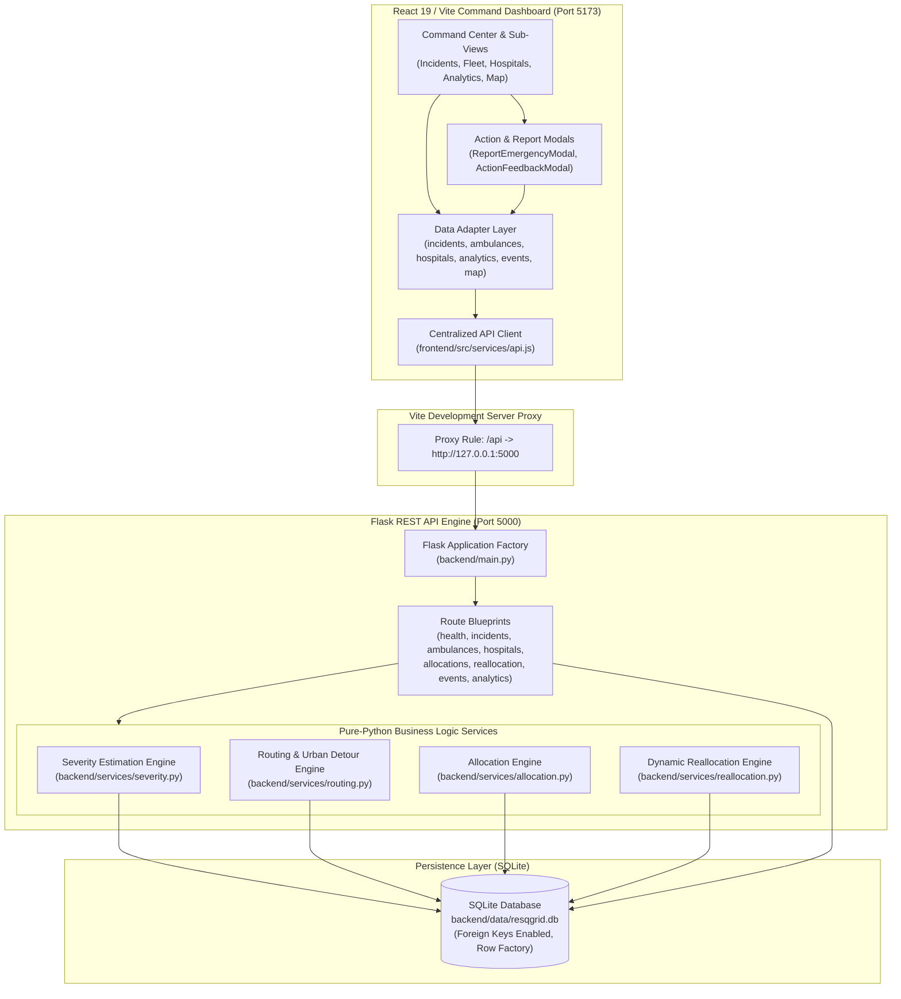
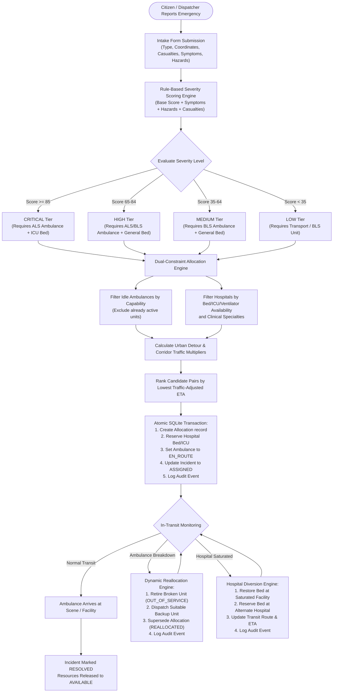
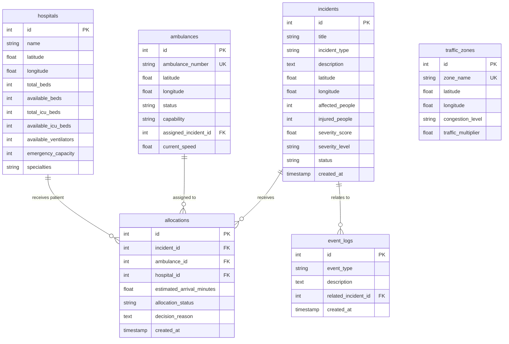

# ResQGrid

> **Intelligent Real-Time Emergency Coordination and Dynamic Resource Allocation Platform**  
> Developed for **YUKTIK-2026 at Keshav Memorial Institute of Technology (KMIT)**.

[](https://www.python.org/)
[](https://flask.palletsprojects.com/)
[](https://react.dev/)
[](https://vitejs.dev/)
[](https://www.sqlite.org/)
[](LICENSE)

---

## Table of Contents

1. [Problem Statement](#1-problem-statement)
2. [Our Solution](#2-our-solution)
3. [Key Features](#3-key-features)
4. [System Architecture](#4-system-architecture)
5. [Technology Stack](#5-technology-stack)
6. [Application Workflow](#6-application-workflow)
7. [Screenshots and Demo](#7-screenshots-and-demo)
8. [Project Structure](#8-project-structure)
9. [Installation and Setup](#9-installation-and-setup)
10. [Environment Configuration](#10-environment-configuration)
11. [API Documentation](#11-api-documentation)
12. [Algorithmic and Decision Approach](#12-algorithmic-and-decision-approach)
13. [Database Design](#13-database-design)
14. [Testing and Verification](#14-testing-and-verification)
15. [Limitations and Future Roadmap](#15-limitations-and-future-roadmap)
16. [Team Members](#16-team-members)
17. [Acknowledgements and License](#17-acknowledgements-and-license)

---

## 1. Problem Statement

Emergency response ecosystems frequently suffer from fragmented communication, manual dispatch delays, and static decision-making:

- **Manual Clinical Triage**: Emergency dispatchers must estimate incident severity manually under intense cognitive load, leading to inconsistent prioritization.
- **Suboptimal Resource Matching**: Standard dispatch models often allocate the closest available vehicle regardless of whether Advanced Life Support (ALS) or Basic Life Support (BLS) is required, or whether the receiving hospital has sufficient ICU or trauma bed capacity.
- **Static Travel Times**: Routine GPS dispatchers calculate straight-line or free-flow driving estimates, failing to model real-time urban road tortuosity or dynamic congestion corridors.
- **Fragile In-Transit Execution**: When an ambulance experiences a mechanical breakdown in transit, a receiving hospital reaches full capacity, or an unexpected traffic spike occurs, dispatch systems lack automated real-time mechanisms to dynamically reroute patients and preserve critical care continuity.

---

## 2. Our Solution

**ResQGrid** is a real-time emergency coordination platform engineered to automate triage assessment, optimize multi-resource allocation, and dynamically respond to in-transit disruption.

Key capabilities include:
- **Transparent Severity Scoring**: Rule-based triage algorithms analyze reported incident types, casualty figures, clinical symptoms, and scene hazards to classify priority from `LOW` to `CRITICAL` (0–100 scale).
- **Dual-Constraint Resource Matching**: Pairs clinical requirements (ALS/BLS capabilities, specialty trauma requirements, ICU bed availability, and mechanical ventilators) with proximity ranking.
- **Traffic-Adjusted Urban Routing**: Computes travel times using Haversine great-circle distances modulated by an urban street network detour factor (1.35×) and intersecting traffic corridor multipliers.
- **Dynamic Event-Driven Reallocation**: Automatically detects and handles en-route disruptions (vehicle breakdown, hospital saturation, or traffic spikes), atomically reallocating replacement resources within SQLite transactions without losing past audit trails.
- **Live Command Center Dashboard**: A React-based interface with live telemetry representations, geographic canvas projection of Hyderabad benchmark coordinates, operational action feedback modals, and immutable SQLite audit logging.

---

## 3. Key Features

### Implemented Functionality

| Capability | Description |
| :--- | :--- |
| **Emergency Incident Reporting** | Multi-attribute report intake including incident title, category, description, coordinates, casualty counts, clinical symptoms, and hazardous environmental factors. |
| **Rule-Based Severity Estimation** | Deterministic clinical scoring engine assigning a 0–100 score and assigning triage tiers: `CRITICAL` (≥85), `HIGH` (65–84), `MEDIUM` (35–64), and `LOW` (<35). |
| **Ambulance Capability Matching** | Enforces capability constraints: ALS incidents require ALS ambulances; BLS incidents accept ALS or BLS units; Patient Transport handles non-emergency transport. |
| **Hospital Capacity Matching** | Evaluates receiving hospitals based on available general beds, dedicated ICU beds, mechanical ventilator inventory, and clinical specialties (e.g., Level-1 Trauma, Cardiology). |
| **Traffic-Adjusted ETAs** | Calculates road distances via circuity factors and integrates dynamic traffic zones (1.0× to 3.0× multipliers) along the transit corridor. |
| **Dynamic Ambulance Reallocation** | Retires broken-down ambulances to `OUT_OF_SERVICE` and automatically dispatches the nearest suitable replacement unit, recomputing arrival times. |
| **Hospital Saturation Diversion** | Automatically redirects active in-transit transports away from saturated emergency departments to alternative qualified facilities. |
| **Traffic Congestion Adaptation** | Detects sudden traffic spikes on transit corridors and dynamically evaluates whether rerouting to an alternative facility is clinically faster. |
| **Hyderabad Geographic Visualization** | Normalizes real Hyderabad coordinates (`17.30°N–17.55°N`, `78.30°E–78.60°E`) onto an interactive 2D command map with out-of-bounds safety filtering. |
| **Live Database-Driven Analytics** | Aggregates real-time incident status distributions, severity breakdowns, fleet readiness metrics, and facility utilization from SQLite without mock fallback. |
| **Immutable Event Audit Trail** | Records all operational actions (`INCIDENT_REPORTED`, `RESOURCE_ALLOCATED`, `AMBULANCE_BREAKDOWN`, `RESOURCE_REALLOCATED`) to SQLite with relational incident links. |

### Planned Future Improvements
- Multi-vehicle simultaneous dispatch for mass-casualty incidents (dispatches currently allocate the primary response unit).
- Live telemetry hardware integration (OBD-II vehicle trackers and GPS transponders).
- Machine learning models trained on historical dispatch outcomes to assist rule-based triage.
- OpenStreetMap / Leaflet tile engine integration replacing the 2D SVG canvas projection.

---

## 4. System Architecture

ResQGrid separates presentation, API orchestration, algorithmic business logic, and transactional persistence into a clean modular structure:



---

## 5. Technology Stack

ResQGrid is built using a lightweight, pure-Python and standard-library backend combined with a responsive React frontend, avoiding unnecessary heavy C-extension dependencies.

### Frontend
- **Framework**: [React 18.3](https://react.dev/) (Functional components, hooks)
- **Build Tooling**: [Vite 6.0](https://vitejs.dev/) with `@vitejs/plugin-react`
- **Icons**: [Lucide React](https://lucide.dev/) (v0.469.0)
- **Styling**: Pure CSS3 with custom variables for dark command-center aesthetic, responsive flex/grid layouts, and CSS keyframe animations.
- **HTTP Client**: Standard `window.fetch` encapsulated in a centralized, typed API client with Vite dev server proxying.

### Backend
- **Framework**: [Flask 3.0+](https://flask.palletsprojects.com/)
- **CORS Support**: [Flask-CORS](https://flask-cors.readthedocs.io/)
- **Language**: Python 3.12+ (standard library modules: `sqlite3`, `math`, `typing`, `json`, `pathlib`, `datetime`, `re`, `logging`, `unittest`)
- **Persistence**: [SQLite 3](https://www.sqlite.org/) with strictly enforced `PRAGMA foreign_keys = ON;`, transaction management, and partial unique indexes.

---

## 6. Application Workflow

The diagram below illustrates the end-to-end lifecycle of an emergency event from intake to final resolution:



---

## 7. Screenshots and Demo

> *Note: Place project screenshot captures in `docs/screenshots/` and update references below.*

| Command Center Dashboard | Report Emergency & Triage Modal |
| :---: | :---: |
| <br>*Real-time fleet readiness, incident feed, and interactive Hyderabad emergency map.* | <br>*Report emergency form with symptom checklists and immediate clinical triage computation.* |

| Dynamic Reallocation & Breakdown Simulation | Real-Time Database Analytics |
| :---: | :---: |
| <br>*Ambulance breakdown simulation showing automated ALS backup dispatch and updated ETA.* | <br>*Live database-aggregated KPIs, capacity meters, and clinical severity distribution.* |

---

## 8. Project Structure

```
ResQGrid-Abhimanyu_26-/
├── backend/
│   ├── .venv/                         # Python virtual environment
│   ├── data/
│   │   └── resqgrid.db                # SQLite database (auto-generated)
│   ├── routes/                        # Modular Flask Blueprint routes
│   │   ├── __init__.py                # Blueprint aggregation & registration
│   │   ├── allocations.py             # POST /api/allocations/<id>
│   │   ├── ambulances.py              # GET /api/ambulances, GET /api/ambulances/<id>
│   │   ├── analytics.py               # GET /api/analytics/overview
│   │   ├── events.py                  # GET /api/events
│   │   ├── health.py                  # GET /api/health
│   │   ├── hospitals.py               # GET /api/hospitals, GET /api/hospitals/<id>
│   │   ├── incidents.py               # GET, POST /api/incidents, PATCH /api/incidents/<id>/status
│   │   └── reallocation.py            # POST /api/reallocation/{breakdown,hospital,traffic}
│   ├── services/                      # Pure-Python algorithmic business logic
│   │   ├── __init__.py
│   │   ├── allocation.py              # Multi-resource matching & capacity reservations
│   │   ├── reallocation.py            # Event-driven dynamic replacement engine
│   │   ├── routing.py                 # Haversine distance, detour circuity & ETA calculations
│   │   └── severity.py                # Rule-based triage scoring & requirement derivation
│   ├── database.py                    # SQLite connection factory, schema & query helpers
│   ├── main.py                        # Flask application factory, CORS & server entrypoint
│   ├── requirements.txt               # Backend dependencies (Flask, Flask-CORS)
│   ├── seed.py                        # Simulated Hyderabad benchmark dataset seeder
│   ├── test_ai_services.py            # Tests for severity scoring & routing algorithms
│   ├── test_allocation.py             # Tests for allocation logic & capacity constraints
│   ├── test_api.py                    # Comprehensive REST API integration test suite
│   ├── test_db.py                     # Database integrity & foreign key constraint tests
│   └── test_reallocation.py           # Tests for dynamic reallocation scenarios
├── frontend/
│   ├── node_modules/                  # Frontend dependencies
│   ├── src/
│   │   ├── adapters/                  # Data adapters normalizing API data for UI
│   │   │   ├── ambulancesAdapter.js
│   │   │   ├── analyticsAdapter.js
│   │   │   ├── eventsAdapter.js
│   │   │   ├── geoAdapter.js
│   │   │   ├── hospitalsAdapter.js
│   │   │   ├── incidentsAdapter.js
│   │   │   ├── index.js
│   │   │   └── verify_adapters.js     # Standalone adapter verification test script
│   │   ├── components/                # Modular React dashboard components
│   │   │   ├── ActionFeedbackModal.jsx
│   │   │   ├── EmergencyMap.jsx
│   │   │   ├── FleetOverview.jsx
│   │   │   ├── Header.jsx
│   │   │   ├── HospitalOverview.jsx
│   │   │   ├── IncidentFeed.jsx
│   │   │   ├── KpiCards.jsx
│   │   │   ├── NotificationDrawer.jsx
│   │   │   ├── ReportEmergencyModal.jsx
│   │   │   └── Sidebar.jsx
│   │   ├── pages/                     # Primary dashboard view screens
│   │   │   ├── AnalyticsView.jsx
│   │   │   ├── CommandCenter.jsx
│   │   │   ├── FleetView.jsx
│   │   │   ├── HospitalsView.jsx
│   │   │   ├── IncidentsView.jsx
│   │   │   └── SettingsView.jsx
│   │   ├── services/
│   │   │   ├── api.js                 # Centralized frontend API client
│   │   │   └── verify_api.js          # Standalone API integration test script
│   │   ├── styles/
│   │   │   ├── dashboard.css          # Command center styling, modals, alert banners
│   │   │   └── global.css             # Base reset and typography
│   │   ├── App.jsx                    # Root coordinator managing live polling & actions
│   │   ├── main.jsx                   # React application entrypoint
│   │   └── verify_e2e_demo.js         # Automated 9-step E2E integration test script
│   ├── package.json                   # React, Vite, Lucide dependencies & build scripts
│   └── vite.config.js                 # Vite dev server configuration & API reverse proxy
├── docs/                              # Project documentation and screenshot assets
├── .gitignore                         # Environment and dependency exclusions
└── README.md                          # Project documentation
```

---

## 9. Installation and Setup

Follow these steps to set up and run ResQGrid on Windows (PowerShell):

### Prerequisites
- **Python**: Version 3.12 or higher installed.
- **Node.js**: Version 18.0 or higher with npm.

### Step 1: Clone Repository
```powershell
git clone https://github.com/Abhimanyu-26/ResQGrid-Abhimanyu_26-.git
cd ResQGrid-Abhimanyu_26-
```

### Step 2: Backend Setup
The repository includes a configured Python virtual environment in `backend/.venv`. If needed, you can activate it or create a new one:

```powershell
# Navigate to backend directory
cd backend

# Option A: Use existing virtual environment
.\.venv\Scripts\Activate.ps1

# Option B: Create a fresh virtual environment and install dependencies
# python -m venv .venv
# .\.venv\Scripts\Activate.ps1
# pip install -r requirements.txt

# Initialize database schema and benchmark Hyderabad data
python seed.py

# Launch the Flask backend server (starts on http://127.0.0.1:5000)
python main.py
```

### Step 3: Frontend Setup
Open a second PowerShell terminal:

```powershell
# Navigate to frontend directory
cd frontend

# Install dependencies
npm install

# Start the Vite development server (starts on http://localhost:5173)
npm run dev
```

### Step 4: Open in Browser
Open your browser and navigate to:
```
http://localhost:5173
```
*Vite automatically forwards all `/api` requests to the Flask backend running on `http://127.0.0.1:5000`.*

---

## 10. Environment Configuration

ResQGrid requires zero third-party API keys or external services to run in development mode.

| Parameter | Default Value | Description |
| :--- | :--- | :--- |
| `DATABASE` | `backend/data/resqgrid.db` | Path to the SQLite persistence file. Automatically created on initial run. |
| `FLASK_PORT` | `5000` | Port for the backend REST API server. |
| `VITE_PORT` | `5173` | Port for the React development frontend. |
| `VITE_PROXY_TARGET` | `http://localhost:5000` | Target backend host configured in `frontend/vite.config.js`. |

---

## 11. API Documentation

All API responses follow a consistent JSON format:
```json
{
  "success": true,
  "data": { ... },
  "message": "Operation description"
}
```

### Health Diagnostics
| Method | Endpoint | Description |
| :--- | :--- | :--- |
| `GET` | `/api/health` | Returns system health, database status, and verified SQLite table count. |

### Incidents
| Method | Endpoint | Query / Body Parameters | Description |
| :--- | :--- | :--- | :--- |
| `GET` | `/api/incidents` | `status`, `severity` (optional query filters) | Returns collection of incidents ordered newest first. |
| `GET` | `/api/incidents/<id>` | None | Returns single incident details including active allocation if assigned. |
| `POST` | `/api/incidents` | Body: `title`, `incident_type`, `description`, `latitude`, `longitude`, `affected_people`, `injured_people`, optional `clinical_signs`, `hazards` | Reports new incident, calculates algorithmic triage score, and saves to SQLite. |
| `PATCH` | `/api/incidents/<id>/status` | Body: `status` (`IN_PROGRESS`, `RESOLVED`, `CANCELLED`), optional `cancellation_reason`, `resolution_notes` | Updates incident status. Releases assigned resources when resolved or cancelled. |

### Ambulances
| Method | Endpoint | Query / Body Parameters | Description |
| :--- | :--- | :--- | :--- |
| `GET` | `/api/ambulances` | `status`, `capability` (optional query filters) | Returns fleet collection with status, capability, location, and speed. |
| `GET` | `/api/ambulances/<id>` | None | Returns individual ambulance details and active dispatch assignment. |

### Hospitals
| Method | Endpoint | Query / Body Parameters | Description |
| :--- | :--- | :--- | :--- |
| `GET` | `/api/hospitals` | `has_icu`, `service` (optional query filters) | Returns hospital directory with bed, ICU, and ventilator capacity. |
| `GET` | `/api/hospitals/<id>` | None | Returns specific hospital details and active trauma capabilities. |

### Emergency Allocations
| Method | Endpoint | Description |
| :--- | :--- | :--- |
| `POST` | `/api/allocations/<incident_id>` | Executes atomic resource dispatch. Matches optimal ambulance capability and receiving hospital capacity based on traffic-adjusted ETA. |

### Dynamic Reallocation
| Method | Endpoint | Request Body | Description |
| :--- | :--- | :--- | :--- |
| `POST` | `/api/reallocation/breakdown` | `{"ambulance_id": 1, "reason": "Engine failure"}` | Retires broken ambulance to `OUT_OF_SERVICE` and dispatches nearest qualified replacement unit. |
| `POST` | `/api/reallocation/hospital` | `{"hospital_id": 1, "reason": "ICU full", "exhausted_resource": "ICU"}` | Diverts in-transit ambulances away from saturated hospital to alternative facilities. |
| `POST` | `/api/reallocation/traffic` | `{"traffic_zone_id": 1, "new_multiplier": 2.5, "new_congestion_level": "SEVERE"}` | Updates traffic zone delay and evaluates rerouting for affected transit corridors. |

### Events Audit & Analytics
| Method | Endpoint | Query Parameters | Description |
| :--- | :--- | :--- | :--- |
| `GET` | `/api/events` | `limit` (1–200, default 50), `event_type` | Retrieves immutable audit event log ordered newest first. |
| `GET` | `/api/analytics/overview` | None | Returns aggregated KPIs: total/active/critical incidents, bed occupancy, and fleet readiness. |

---

## 12. Algorithmic and Decision Approach

ResQGrid implements transparent, deterministic algorithms to ensure predictability and clinical explainability:

### 1. Rule-Based Clinical Severity Scoring
The severity scoring engine evaluates multiple emergency indicators:

$$\text{Severity Score} = \text{Clamp}\Big(\text{Base}(\text{Type}) + \sum \text{Symptoms} + \sum \text{Hazards} + \text{CasualtyBonus}, 0, 100\Big)$$

- **Incident Type Base Scores**: E.g., `CARDIAC_EMERGENCY` (50 pts), `MASS_CASUALTY` (48 pts), `ROAD_ACCIDENT` (38 pts), `MINOR_INJURY` (10 pts).
- **Critical Symptom Keywords**: E.g., *Cardiac arrest* (+25), *Airway compromise* (+22), *Unconscious* (+20), *Massive hemorrhage* (+20).
- **Environmental Hazard Modifiers**: E.g., *Structural collapse* (+16), *Active fire* (+16), *Toxic chemical leak* (+18), *Rising floodwater* (+15).
- **Casualty Scaling**:
  $$\text{CasualtyBonus} = \min(20, \text{Injured} \times 4.0 + \text{Affected} \times 1.5)$$
- **Triage Thresholds**:
  - `CRITICAL`: $\ge 85.0$ (Requires ALS ambulance, immediate ICU / Trauma reservation)
  - `HIGH`: $65.0 - 84.9$ (Requires ALS or BLS ambulance, hospital bed reservation)
  - `MEDIUM`: $35.0 - 64.9$ (Requires BLS ambulance, emergency department intake)
  - `LOW`: $0.0 - 34.9$ (Non-emergency transport)

### 2. Haversine Distance and Urban Detour Routing
Great-circle distance between two coordinates $(lat_1, lon_1)$ and $(lat_2, lon_2)$ is calculated using the Haversine formula:

$$d = 2 R \arcsin\left(\sqrt{\sin^2\left(\frac{\Delta\phi}{2}\right) + \cos(\phi_1)\cos(\phi_2)\sin^2\left(\frac{\Delta\lambda}{2}\right)}\right)$$

Where $R = 6371.0088\text{ km}$. To reflect actual street networks rather than straight lines across city blocks, ResQGrid applies an urban detour circuity multiplier:

$$\text{Road Distance} = d \times 1.35$$

### 3. Traffic-Adjusted Travel Time Modeling
Travel times are estimated based on base emergency transit speed ($v = 40\text{ km/h}$) and modulated by traffic congestion zones along the corridor:

$$\text{ETA (minutes)} = \left(\frac{\text{Road Distance}}{40\text{ km/h}} \times 60\right) \times \text{Corridor Traffic Multiplier}$$

Corridor traffic multipliers are calculated by sampling points along the transit vector against congestion zones within a $2.5\text{ km}$ influence radius.

### 4. Dynamic Reallocation Safety
When an in-transit disruption occurs:
1. Past allocation records are transitioned from `ACTIVE` to `REALLOCATED` (never deleted, ensuring complete auditability).
2. Hospital bed capacity is restored at the departing facility and decremented at the receiving facility within an atomic SQLite transaction.
3. If no replacement resource is available, the incident is placed into a prioritized unfulfilled queue and logged with an audit event (`SHORTAGE_UNRESOLVED`).

---

## 13. Database Design

ResQGrid uses SQLite with strict foreign key constraints and transactional integrity.



### Constraints & Indexes
- **Single Active Allocation**: A partial unique index prevents an ambulance from receiving multiple simultaneous active dispatches:
  ```sql
  CREATE UNIQUE INDEX idx_active_ambulance_allocation
  ON allocations(ambulance_id)
  WHERE allocation_status = 'ACTIVE';
  ```
- **Foreign Key Enforcement**: `PRAGMA foreign_keys = ON;` is strictly enforced on every database connection.

---

## 14. Testing and Verification

ResQGrid includes comprehensive test suites across backend logic, database constraints, frontend data adapters, and end-to-end integration:

### Running Test Suites

#### 1. Backend Unit & API Tests (87 Tests)
```powershell
cd backend
.\.venv\Scripts\python.exe -m unittest discover -s . -p "test_*.py"
```
*Covers severity estimation, routing formulas, allocation engine, dynamic reallocation scenarios, database isolation, and all REST endpoints.*

#### 2. Database Verification & Foreign Key Constraints
```powershell
cd backend
.\.venv\Scripts\python.exe test_db.py
```
*Validates table schema, seeding idempotence, foreign key cascade behaviors, and the active allocation unique index.*

#### 3. Frontend Data Adapter Verification (11 Tests)
```powershell
node frontend/src/adapters/verify_adapters.js
```
*Validates field mapping, coordinate projection, null resilience, and truthful display of unrecorded telemetry.*

#### 4. End-to-End Demo Workflow Verification (9 Steps)
With the backend server running:
```powershell
node frontend/src/verify_e2e_demo.js
```
*Executes a live 9-step simulation:*
1. Health & connectivity check
2. Live command center KPI retrieval
3. Incident creation with clinical triage calculation
4. Primary resource allocation (ALS vehicle + trauma hospital)
5. Synchronized state verification across models
6. Ambulance breakdown simulation
7. Dynamic replacement dispatch with revised ETA
8. Immutable SQLite audit trail verification

---

## 15. Limitations and Future Roadmap

- **Prototype Scope**: ResQGrid is developed as an emergency logistics prototype for hackathon demonstration. It is not approved for production 911/108 dispatch or clinical medical diagnosis.
- **Simulated Geographic Data**: Uses realistic benchmark coordinates and traffic zones representing Hyderabad, Telangana, India.
- **Unrecorded Telemetry**: Field metrics like physical GPS transponder logs and mechanical fuel levels are marked as `"Pending telemetry"` or `"N/A"` rather than fabricated.
- **Future Roadmap**:
  - Implement WebSockets / Server-Sent Events (SSE) for sub-second push notifications.
  - Multi-vehicle dispatch support for mass-casualty incidents.
  - Integration with OpenStreetMap / Mapbox live traffic routing APIs.
  - Mobile application for field paramedics to update patient status in transit.

---

## 16. Team Members

Developed for **YUKTIK-2026** at **Keshav Memorial Institute of Technology (KMIT)**:

- **Akhila**
- **Surya Teja**
- **Sri Charan**
- **Harshith**
- **Sai Sahasra**
- **Mokshith**

---

## 17. Acknowledgements and License

- **Event**: YUKTIK-2026 Hackathon, Keshav Memorial Institute of Technology (KMIT).
- **Inspirations**: Emergency Medical Services (EMS) triage protocols, trauma center routing systems, and urban mobility research.
- **License**: Released under the [MIT License](LICENSE).
